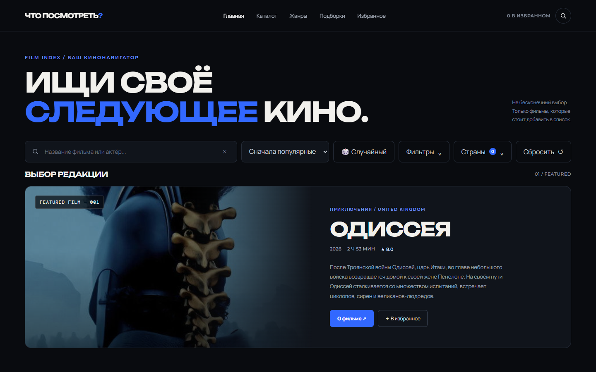
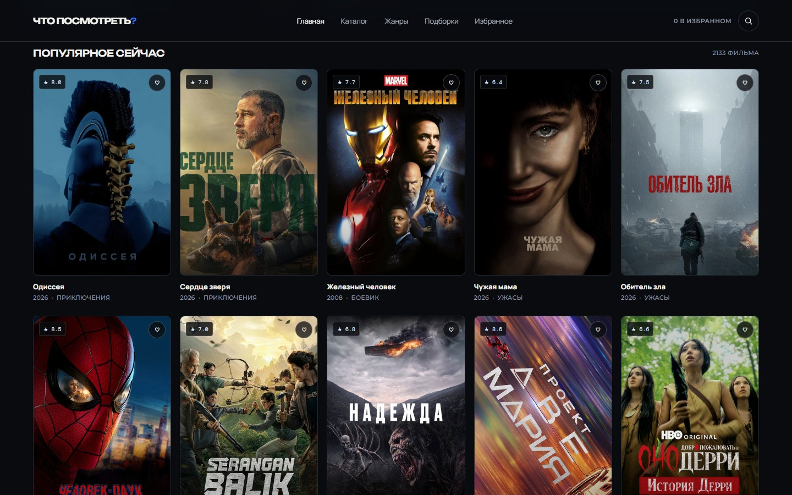
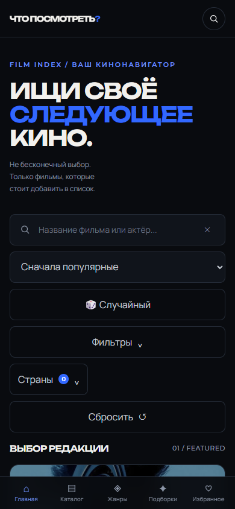

<div align="center">

# 🎬 ЧТО ПОСМОТРЕТЬ?

### Твой навигатор по миру кино

Находи фильмы под настроение, изучай рейтинги и актёрский состав, собирай личный список и открывай для себя новое кино — на сайте и в нативном Android-приложении.

[](https://fvkhweb.github.io/movie-site/)
[](android/README.md)

<br>


</div>

---

## ✦ Как это выглядит

<p align="center">
  
</p>

| Главная | Каталог |
|:--:|:--:|
|  |  |

<p align="center">
  
</p>

## ✦ О проекте

**«Что посмотреть?»** — каталог фильмов с поиском, фильтрами и персональными подборками. Проект существует в двух видах:

- **Сайт** — статический HTML/CSS/JS на GitHub Pages. Отдельный сервер и база данных не нужны.
- **Android-приложение** — нативное, на Kotlin и Jetpack Compose. Повторяет сайт, работает офлайн и обновляется само.

Информация о фильмах заранее собирается в JSON-файлы. База пополняется каждый день: новые фильмы, рейтинги, актёры, факты, кадры и постеры. Сейчас в ней **более 2 200 фильмов**; часть дальних премьер не показывается в общем каталоге и живёт в разделе «Скоро в кино».

Постеры TMDB хранятся в репозитории (`posters/`, около 200 МБ) и раздаются с домена сайта — так каталог остаётся доступным там, где внешние CDN работают нестабильно. Карточки, добавленные из Кинопоиска, используют удалённые постеры Яндекс.CDN: их не нужно скачивать, и репозиторий не растёт.

## ✦ Возможности

| Раздел | Что внутри |
|:--|:--|
| **Каталог** | Поиск по названию и актёрам, фильтры по жанрам, годам, рейтингу и странам |
| **Сортировка** | По популярности, рейтингу, рейтингу Кинопоиска, году, названию и длительности |
| **Подборки** | Популярное, фильмы с высоким рейтингом, жанровые и тематические коллекции |
| **Киноафиша** | Разделы «Сейчас в кино» и «Скоро в кино» |
| **Страница фильма** | Описание, дата выхода, длительность, страны, жанры, рейтинги TMDB и Кинопоиска |
| **Актёрский состав** | Фотографии актёров, роли и переход к фильмам с их участием |
| **Дополнительно** | Трейлеры, похожие фильмы, кадры и интересные факты — если данные доступны |
| **Избранное** | `localStorage` на сайте и `DataStore` в приложении; список переживает обновления |
| **Случайный выбор** | Помогает найти фильм, когда не знаешь, что включить |
| **Офлайн** | Android-приложение стартует из локального снимка каталога и кэширует постеры |

Также предусмотрены адаптация под мобильные экраны, постепенная загрузка карточек и состояния загрузки.

## ✦ Как это устроено

```text
              TMDB                    Кинопоиск
                │                        │
                └───────────┬────────────┘
                            ▼
                 scripts/fetch_movies.py
                   сбор и обработка данных
                            │
                ┌───────────┴───────────┐
                ▼                       ▼
          data/*.json              posters/*.jpg
          данные каталога          локальные постеры
                │                       │
                └───────────┬───────────┘
                            ▼
                     GitHub Pages
                            │
                ┌───────────┴───────────┐
                ▼                       ▼
          сайт (HTML/CSS/JS)      Android (Kotlin/Compose)
```

Сайт загружает готовые файлы из `data/` и `posters/`. GitHub Actions по расписанию запускает Python-скрипт, обновляет каталог и сохраняет изменения в репозитории.

Импорт новых фильмов из Кинопоиска выключен в ежедневном прогоне и запускается вручную: так проще контролировать качество и не тратить квоты API. Дубли с TMDB отбрасываются, а новые карточки попадают в каталог, поиск и фильтры — но не на главную, где подборки строятся по рейтингам TMDB.

## ✦ Технологии

- **HTML5** — структура страниц.
- **CSS3** — оформление и адаптация интерфейса.
- **JavaScript** — поиск, фильтрация, сортировка и взаимодействие с каталогом.
- **Python 3.12** — сбор и подготовка информации о фильмах.
- **GitHub Actions** — автоматическое обновление данных.
- **GitHub Pages** — публикация сайта и файлов приложения.
- **Kotlin + Jetpack Compose** — нативное Android-приложение.
- **OkHttp, Coil, DataStore** — сеть, кэш изображений и локальное избранное в приложении.

## ✦ Запуск локально

### Сайт

```bash
git clone https://github.com/fvkhweb/movie-site.git
cd movie-site
python -m http.server 8000
```

Открой в браузере:

```text
http://localhost:8000
```

Дополнительные зависимости для просмотра сайта не нужны. Небольшой локальный HTTP-сервер нужен, чтобы браузер корректно загружал JSON-файлы.

### Android-приложение

Нужны JDK 17 и Android SDK 35 (или Android Studio):

```bash
cd android
./gradlew assembleDebug
```

APK появится в `android/app/build/outputs/apk/debug/app-debug.apk`. Подробности — в [`android/README.md`](android/README.md).

## ✦ Обновление базы фильмов

Данные собираются скриптом `scripts/fetch_movies.py`. Для его запуска установи Python и библиотеку `requests`:

```bash
python -m pip install requests
```

Затем задай ключ TMDB и запусти скрипт:

```bash
export TMDB_API_KEY="твой_ключ"
python scripts/fetch_movies.py
```

В PowerShell:

```powershell
$env:TMDB_API_KEY="твой_ключ"
python scripts/fetch_movies.py
```

Ключи Кинопоиска используются для рейтингов, описаний, фактов и кадров:

```bash
export POISKKINO_API_KEY="ключ_kinopoisk.dev"
export KP_UNOFFICIAL_API_KEY="ключ_unofficial"
```

В каждый секрет можно записать несколько ключей через запятую — скрипт распределяет запросы по кругу и отключает исчерпанные.

### Автоматическое обновление

Workflow **Update movies** в GitHub Actions:

- запускается автоматически каждый день в **06:00 UTC**;
- может быть запущен вручную через `Actions → Update movies → Run workflow`;
- собирает свежие данные и обновляет папки `data/` и `posters/`.

Для работы автоматического обновления добавь ключи в **Settings → Secrets and variables → Actions**:

| Секрет | Назначение |
|:--|:--|
| `TMDB_API_KEY` | Основной источник данных. Обязателен для сборки. |
| `POISKKINO_API_KEY` | Ключи [kinopoisk.dev](https://kinopoisk.dev/): рейтинги, описания, постеры. Можно несколько через запятую. |
| `KP_UNOFFICIAL_API_KEY` | Ключи Kinopoisk Unofficial API: факты, кадры, резервные постеры. Можно несколько через запятую. |

Не публикуй API-ключи в исходном коде или открытых файлах репозитория.

### Ручной импорт фильмов Кинопоиска

В ручном запуске workflow доступны параметры:

| Параметр | Значение |
|:--|:--|
| `import_limit` | Сколько новых фильмов добавить. `0` — не импортировать (обычный ежедневный режим). |
| `import_source` | `auto` — сначала kinopoisk.dev, затем Unofficial; либо `dev` / `unofficial` принудительно. |

Импорт пропускает фильмы, которые уже есть в базе, и добавляет только новые карточки. Для первой проверки достаточно `import_limit = 100`–`1000`.

## ✦ Структура проекта

```text
movie-site/
├── .github/
│   └── workflows/
│       └── update-movies.yml   # ежедневное обновление каталога
├── android/                    # нативное Android-приложение
├── app/                        # релизы APK и latest.json
├── data/
│   ├── movies.json             # информация о фильмах
│   ├── genres.json             # список жанров
│   ├── lists.json              # готовые списки фильмов
│   ├── collections.json        # тематические подборки
│   ├── cast.json               # актёрский состав
│   ├── people.json             # индекс актёров
│   └── kp_state.json           # cooldown повторных запросов к Кинопоиску
├── docs/screenshots/           # изображения для README
├── fonts/                      # шрифты сайта и приложения
├── icons/                      # иконки PWA
├── posters/                    # локальные постеры TMDB
├── scripts/
│   └── fetch_movies.py         # сбор и обработка данных
├── app.js                      # логика сайта
├── index.html                  # разметка сайта
├── style.css                   # стили
├── sw.js                       # service worker
└── README.md
```

`data/kp_state.json` создаётся автоматически после первого прогона: в нём хранится дата последней попытки для фильмов, которые не нашлись в Кинопоиске, чтобы не тратить квоту на них каждый день.

## ✦ Android-приложение

Приложение повторяет сайт 1:1: тёмная тема, сетка 2/4/5 колонок, шрифты Unbounded / Manrope / DM Mono. Данные берутся с GitHub Pages, постеры кэшируются на устройстве, избранное хранится в `DataStore`.

- Сборка: `cd android && ./gradlew assembleDebug`.
- Релиз и автообновление: `android/release.ps1` собирает подписанный APK, кладёт его в `app/` и обновляет `app/latest.json`.
- Приложение проверяет манифест обновлений, сверяет `versionCode`, SHA-256 и подпись APK.

Подробности, ограничения и команды — в [`android/README.md`](android/README.md).

## ✦ Источники данных

Информация о фильмах и дополнительные материалы собираются из следующих источников:

- [TMDB](https://www.themoviedb.org/) — каталог, жанры, рейтинги, актёры и рекомендации.
- [kinopoisk.dev](https://kinopoisk.dev/) и [Kinopoisk Unofficial API](https://kinopoiskapiunofficial.tech/) — дополнительные рейтинги, описания, постеры, факты и кадры.

Доступность отдельных сведений зависит от наличия данных у источников и ограничений API.

---

<div align="center">

**Не бесконечный выбор. Только фильмы, которые стоит добавить в список.**

[Перейти к каталогу →](https://fvkhweb.github.io/movie-site/)

</div>
